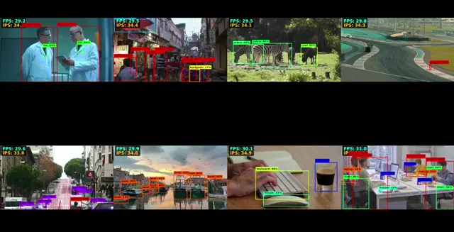
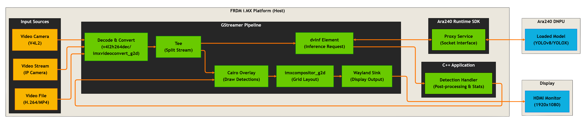

[](https://www.nxp.com)

# Ara240 Vision Examples

[](./LICENSE.txt)
[](https://www.nxp.com/products/processors-and-microcontrollers/arm-processors/i-mx-applications-processors:IMX_HOME)
[](https://isocpp.org/)
[](https://www.nxp.com/docs/en/user-guide/UG10166.pdf)
[](https://www.nxp.com/design/design-center/software/embedded-software/i-mx-software/embedded-linux-for-i-mx-applications-processors:IMXLINUX)

See how **Ara240** transforms edge vision AI with real-time object detection running on NXP i.MX platforms. This repository contains comprehensive vision examples for i.MX Application Processors, using the **Ara240** *Discrete Neural Processing Unit* (DNPU) accelerator.
Demonstrating real-time video processing with AI/ML inference capabilities at the edge.
Including object detection, object classification, pose estimation, and semantic segmentation.

## Table of Contents
1. [Software](#step1)
2. [Hardware](#step2)
3. [Setup](#step3)
4. [Results](#step4)
5. [FAQs](#step5) 
6. [Support](#step6)
7. [Release Notes](#step7)

## 1. Software<a name="step1"></a>

### Available examples

| Snapshot | Name | &nbsp;&nbsp;&nbsp;&nbsp;&nbsp;&nbsp;Supported Platforms | &nbsp;&nbsp;&nbsp;&nbsp;&nbsp;&nbsp;Implementation | &nbsp;&nbsp;&nbsp;&nbsp;&nbsp;&nbsp;Supported Models |
| :--- | --- | --- | :--- | :--- |
| <a href="./tasks/object-detection/yolo/multistream-gstreamer/README.md"></a> | [multistream_yolo](./tasks/object-detection/yolo/multistream-gstreamer/README.md) | <ul><li>FRDM i.MX 8M Plus</li><li>FRDM i.MX 95</li><li>FRDM i.MX 95 PRO</li></ul> | &nbsp;&nbsp;&nbsp;&nbsp;&nbsp;&nbsp;C++ | <ul><li>YOLOv8n, YOLOv8s, YOLOv8m, YOLOv8l, YOLOv8x </li><li>YOLOxt, YOLOxs, YOLOxm, YOLOxl, YOLOxx </li><li>YOLO11n, YOLO11s, YOLO11m, YOLO11l, YOLO11x </li></ul>|

### 1.1 Multi-stream Yolo

This solution processes one or multiple video streams, generating visual outputs with bounding boxes around detected objects, along with classification labels and confidence scores.
Designed to showcase the performance, scalability, and responsiveness of the **Ara240** architecture, this application highlights how advanced AI workloads can be executed locally at the edge. By leveraging the **Ara240** compute capabilities for on-device inference, the system reduces latency, minimizes cloud dependency, and enables faster decision-making for next-generation smart cameras, industrial automation systems, and intelligent edge devices.
The application supports both single-stream and multi-stream operation, demonstrating how **Ara240** can efficiently scale from basic vision use cases to complex deployments requiring simultaneous analysis of multiple video feeds.

#### 1.1.1 Multi-stream Yolo Software Architecture



## 2. Hardware<a name="step2"></a>

### 2.1 Supported Platforms

| Platform            | Supported |
| ------------------- | :-------: |
| [FRDM i.MX 8M Plus](https://www.nxp.com/design/design-center/development-boards-and-designs/FRDM-IMX8MPLUS) |    ✅     |
| [FRDM i.MX 95](https://www.nxp.com/design/design-center/development-boards-and-designs/FRDM-IMX95)      |    ✅     |
| [FRDM i.MX 95 PRO](https://www.nxp.com/FRDM-IMX95-PRO)  |    ✅     |

### 2.2 Required hardware 

- Supported FRDM i.MX platform
- microSD card (recommended size >=64 GB)
- [Ara240 16GB M.2 Module](https://www.nxp.com/design/design-center/development-boards-and-designs/ARA2-M2-16G-GT)
- USB-C power supply (5V/3A recommended)
- 1920x1080 HDMI display monitor
- 1920x1080 USB camera
- HDMI cable
- USB mouse
- Two USB-C to USB-A debug cables
- USB hub (optional)

## 3. Setup<a name="step3"></a>
Since **Ara240 Vision Examples** is already part of i.MX Linux BSP, you can simply download a pre-built BSP image from NXP's Official website and flash it to your FRDM i.MX board to install it.
The detailed steps for testing this application are provided below.

### 3.1 Installation

1. Donwload the Linux i.MX image (version 6.18.20_2.0.0 or greater) corresponding to your FRDM i.MX board from [Embedded Linux for i.MX](https://www.nxp.com/design/design-center/software/embedded-software/i-mx-software/embedded-linux-for-i-mx-applications-processors:IMXLINUX). 
2. Download the [Universal Update Utility](https://github.com/nxp-imx/mfgtools) (release version 1.5.243 or latest).
3. Configure the Boot Switch on the FRDM board to *serial downloader* mode (make sure the board is turned off), please refer to the Quick Start Guide corresponding to yout FRDM i.MX board for this step:
	- [FRDM i.MX 8M Plus Quick Start Guide](https://www.nxp.com/docs/en/quick-reference-guide/FRDMIMX8MPLUSQSG.pdf)
	- [FRDM i.MX 95 Quick Start Guide](https://www.nxp.com/docs/en/quick-reference-guide/FRDMIMX95QSG.pdf)
	- [FRDM i.MX 95 Pro Quick Start Guide](https://www.nxp.com/docs/en/user-guide/FRDMIMX95PROQSG.pdf)
4. Insert the SD card in the FRDM i.MX board.
5. Connect your FRDM i.MX board to the power supply and connect its USB-C and DEBUG ports to your host machine.
6. Open a terminal in your host machine and run the Universal Update Utility using the following command along with the `.bin-flash` file and the `.wic` image corresponding to your FRDM i.MX board:
	```bash
	.\uuu.exe -b sd_all <imx-boot-*.bin-flash> <imx-image-full-*.wic>
	```
7. Power on the FRDM i.MX board and wait for the flashing process to complete.

### 3.2 Running Ara240 Vision Examples

This application is already available in NXP's [GoPoint for i.MX Applications Processors](https://www.nxp.com/design/design-center/software/i-mx-developer-resources/gopoint-for-i-mx-applications-processors:GOPOINT) launcher, to run it follow the next steps:
1. Connect the HDMI display, USB camera and mouse to your FRDM i.MX board (a USB hub might be needed). 
2. Configure the Boot Switch on the FRDM board to *USDHC2 4-bit SD3.0* mode (make sure the board is turned off).
3. Connect the **Ara240 16GB M.2 Module** to the FRDM i.MX board.
4. Power on the FRDM i.MX board and wait for the boot process to complete.
5. Connect the FRDM i.MX board to the internet, for detailed information about Wi-Fi or Ethernet connectivity please refer to [i.MX Linux User's Guide](https://www.nxp.com/docs/en/user-guide/UG10163.pdf) chapter 11.
6. Once the boot process is completed click the **GoPoint** icon that appears in the upper left corner of the screen.
7. Navigate inside **GoPoint** interface and select **Ara240 Vision Examples**, then click the **Launch Demo** button.
8. Download the available models and video samples inside the **Ara240 Vision Examples** Interface.
9. Now you can run the Multi-stream Yolo example using the input source and number of streams of your choice, for detailed information about running this example please refer to [multistream_yolo](./tasks/object-detection/yolo/multistream-gstreamer/README.md) documentation. 

## 4. Results<a name="step4"></a>

The following animations show the Multi-stream Yolo example running with different number of video streams.

<div align="center">
<br/>
  <figure>
    
  </figure>
</div>

<div align="center">
  <em> Preview 1. Demonstration of Multi-stream Yolo working on a single video stream. </em>
  <br></br>
</div> 

<div align="center">
<br></br>
  <figure>
    
  </figure>  
</div>

<div align="center">
  <em>Preview 2. Demonstration of Multi-stream Yolo working on four video streams.</em>
  <br></br>
</div> 

<div align="center">
<br></br>
  <figure>
    
  </figure>  
</div>

<div align="center">
  <em>Preview 3. Demonstration of Multi-stream Yolo working on eight video streams.</em>
  <br></br>
</div> 

## 5. FAQs<a name="step5"></a>

### 5.1 Application won't start
The Multi-stream Yolo Application needs the models and sample videos to be downloaded properly before start, make sure these files exist:

- Check if the model is downloaded: 
	```bash
	ls /usr/share/cnn/detection
	```
- Check if the sample videos are downloaded: 
	```bash
	ls /usr/share/ara2-vision-examples/sample_videos
	```
If these directories look empty, there might be an issue with your Internet connection, In that case follow these steps:
- Make sure the system date is correct using the `date` command, if it's incorrect, update it: 
	```bash
	date -s 'Tue 6 Oct 09:19:34 PDT 2026'
	```
- Configure your system's DNS server:
	```bash
	echo nameserver 8.8.8.8 > /etc/resolv.conf
	```

### 5.2 Can I set the application to process custom videos?
Yes, you can replace the default sample videos with your own content, just consider the following:
1. The videos must be stored in location: `/usr/share/ara2-vision-examples/sample_videos` and named following the pattern: `video_N.ts` (where N is 0-7).
2. The videos must have a reasonable resolution (recommended: 640x360 or higher).
3. The videos should be in H.264/MP4 format, for video format conversion please refer to [multistream_yolo](./tasks/object-detection/yolo/multistream-gstreamer/README.md) documentation. 

## 6. Support<a name="step6"></a>
#### Project Metadata

<!----- Boards ----->
[]()
[]()
[]()

<!----- Categories ----->
[](https://mcuxpresso.nxp.com/appcodehub?category=aiml)
[](https://mcuxpresso.nxp.com/appcodehub?category=vision)

<!----- Peripherals ----->
[](https://mcuxpresso.nxp.com/appcodehub?peripheral=hdmi)
[](https://mcuxpresso.nxp.com/appcodehub?peripheral=display)

<!----- Toolchains ----->
[](https://mcuxpresso.nxp.com/appcodehub?toolchain=gcc)


Questions regarding the content/correctness of this example can be entered as Issues within this GitHub repository.

>**Note**: For more general technical questions regarding NXP Microcontrollers and the difference in expected functionality, enter your questions on the [NXP Community Forum](https://community.nxp.com/)

[](https://www.youtube.com/NXP_Semiconductors)
[](https://www.linkedin.com/company/nxp-semiconductors)
[](https://www.facebook.com/nxpsemi/)
[](https://x.com/NXP)

## 7. Release Notes<a name="step7"></a>
| Version | Description / Update                           | Date                        |
|:-------:|------------------------------------------------|----------------------------:|
| 1.0     | Initial release on Application Code Hub        | October 6<sup>th</sup> 2026 |

## Licensing

NXP Proprietary. This software is owned or controlled by NXP and
may only be used strictly in accordance with the applicable
license terms. By expressly accepting such terms or by
downloading, installing, activating and/or otherwise using the
software, you are agreeing that you have read, and that you
agree to comply with and are bound by, such license terms. If
you do not agree to be bound by the applicable license terms,
then you may not retain, install, activate or otherwise use the
software.

This repository is licensed under the
[LA_OPT_Online Code Hosting NXP_Software_License](./LICENSE.txt)
license.

