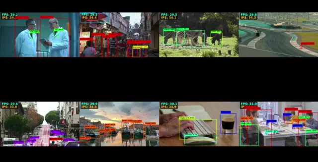
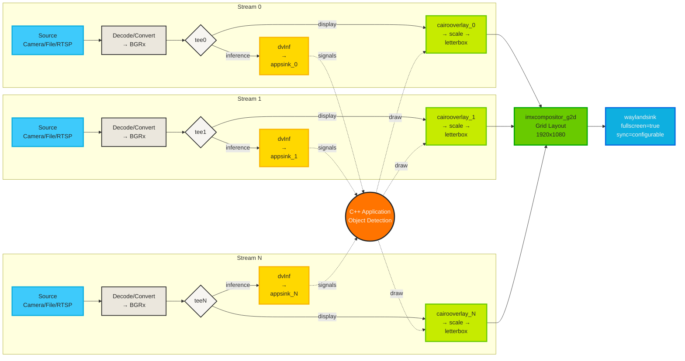

<div align="center">

# Multi-stream GStreamer Example for YOLOv8 / YOLOX / YOLO11 / YOLO26

[](./LICENSE.txt)
[](https://www.nxp.com/products/processors-and-microcontrollers/arm-processors/i-mx-applications-processors:IMX_HOME)
[](https://isocpp.org/)
[](https://www.nxp.com/docs/en/user-guide/UG10166.pdf)

---

</div>

## 📖 Example Description

This example demonstrates multi-stream object detection using
YOLOv8, YOLOX, YOLO11, and YOLO26 models accelerated by the NXP Ara240 
DNPU. It leverages GStreamer to process up to 
**eight simultaneous video streams** from **multiple input sources** 
including cameras 📹, video files 🎬, RTSP streams 📡.

<div align="center">

<br><i>Figure 1. Object detection on eight video streams running on FRDM i.MX 95.</i>
</div>

## 🔰 GStreamer Pipeline - Block Diagram

Below is a block diagram representing the multi-stream
GStreamer pipeline for this example.



## ✨ Key Features

- 🎥 **Multi-Stream Processing**: Handles 1 to 16 videos
  streams concurrently with real-time* object detection
- 🔀 **Multiple Input Sources**: Support for cameras, video
  files, and RTSP streams
- 📹 **Camera Support**: Direct V4L2 camera input with
  hardware-accelerated ISP
- 🎬 **Video File Support**: H.264, H.265 video file playback with
  hardware decoding
- 📡 **RTSP Streaming**: Connect to IP cameras and RTSP
  sources
- 🔀 **Mixed Sources**: Combine different input types in a
  single session
- 📄 **JSON Configuration**: Load complex multi-stream
  setups from configuration files
- ⚡ **Hardware Acceleration**: Utilizes NXP Ara240 DNPU
  for efficient YOLOv8, YOLOX, YOLO11, and YOLO26 inference
- 🎯 **Multiple Model Support**: Choose from YOLOv8,
  YOLOX, YOLO11, and YOLO26 variants (nano, small, medium, large,
  extra-large) to balance speed and accuracy
- 🎬 **GStreamer Integration**: Built on robust GStreamer
  framework for video processing and pipeline management
- 👁️ **Visual Output**: Displays detected objects with
  bounding boxes in a mosaic layout
- 🔄 **Configurable Synchronization**: Runtime control of
  frame synchronization behavior via command-line flag
- 📊 **Real-time Performance Metrics**: Live FPS (Frames
  Per Second) and IPS (Inferences Per Second) overlay for
  each stream
- 📈 **Detailed Performance Stats Mode**: Optional extended
  performance diagnostics
- 🎯 **Object Tracking**: Optional ByteTrack-based tracker
  that assigns persistent IDs to detected objects across
  frames, with configurable class filtering

## 🎯 Target Applications

- 📹 Multi-camera surveillance systems
- 🏭 Industrial monitoring and quality control
- 🏙️ Smart city infrastructure
- 🛒 Retail analytics
- 🚗 Autonomous vehicle testing and validation
- 🏢 Building security and access control
- 🚦 Traffic monitoring and analysis
- 📡 Remote monitoring via RTSP streams

## 💻 Supported Platforms

| Platform            | Supported |
| ------------------- | :-------: |
| [FRDM i.MX 8M Plus](https://www.nxp.com/design/design-center/development-boards-and-designs/FRDM-IMX8MPLUS) |    ✅     |
| [FRDM i.MX 95](https://www.nxp.com/design/design-center/development-boards-and-designs/FRDM-IMX95)      |    ✅     |
| [FRDM i.MX 95 PRO](https://www.nxp.com/FRDM-IMX95-PRO)  |    ✅     |

## ⚙️ Features

### 🔧 Technical Specifications

#### 🤖 AI Model

- **Framework**: Optimized for NXP Ara240 DNPU
- **Object Classes**: 80 COCO dataset classes
- **Detection Capabilities**: Real-time object detection
- **Model Variants**: YOLOv8n, YOLOv8s, YOLOv8m, YOLOv8l,
  YOLOv8x, YOLOXt, YOLOXs, YOLOXm, YOLOXl, YOLOXx, YOLO11n, 
  YOLO11s, YOLO11m, YOLO11l, YOLO11x,
  YOLO26n, YOLO26s, YOLO26m, YOLO26l, YOLO26x

#### 🎬 Video Processing

- **Camera Input**: V4L2 compatible cameras with ISP
  support
- **RTSP Streaming**: IP cameras and network video sources
- **Video Files**: .ts with H.264/H.265 codec support
- **Buffering**: Hardware-accelerated video decoding
- **Codec Auto-Detection**: At startup, the application detects the codec of each
  stream and displays it in the stream summary table:
  - **Video files**: detected via `gst-discoverer-1.0`
  - **RTSP streams**: detected via RTSP DESCRIBE / SDP negotiation
  - **Camera streams** (V4L2 / libcamera): always `raw` (uncompressed YUV output)

- **Resolution Discovery**: the table also reports each stream's
  **Initial Resolution** (what the source actually sends) and **Final
  Resolution** (the size the pipeline and the model see):
  - **Video files**: probed from the file.
  - **RTSP streams**: probed from the live stream before the pipeline is
    built, in parallel for all RTSP streams. For H.264/H.265 the size is read
    from the stream parameters without decoding. The wait is bounded (default
    5 s, override with `RTSP_PROBE_TIMEOUT_SEC=<1-60>`). If the probe fails
    (camera down, wrong URL, auth error) a warning with the reason is printed,
    the Initial Resolution shows `unknown`, and a 640x360 fallback is used for
    the pipeline.
  - **V4L2 cameras**: the configured capture size.
  - **Final Resolution** is the initial size scaled, keeping the aspect ratio,
    to fit the model input (rounded down to even numbers). A source smaller
    than the model is scaled up to fill it. This applies to every source
    type, including auto-discovered sample videos.

  Example startup output for a 512x320 model:
  | Stream   | Initial Resolution   | Final Resolution  | Codec    |
  |----------|----------------------|-------------------|----------|
  | 0        | 1920x1080            | 512x288           | h264     |
  | 1        | 1280x720             | 512x288           | h265     |
  | 2        | 640x480              | 426x320           | raw      |
  | 3        | unknown              | 640x360           | h264     |

  Stream 3 is an RTSP source whose probe failed.

#### 🔌 Connectivity Options

- **PCIe Interface**: High-bandwidth endpoint for maximum
  throughput
- **Endpoint Selection**: Runtime configurable via
  command-line options

#### 📏 Scalability

- **Stream Configuration**: Dynamically adjustable from 1
  to 16 streams
- **Graceful Degradation**: Maintains performance with
  varying stream counts

## 📋 Requirements

### 🧰 Hardware

- Supported FRDM i.MX platform
- Ara240 DNPU
- Power supply (5V/3A recommended)
- USB-C debug cable
- HDMI Cable
- 1920x1080 Display monitor
- 📹 **Optional**: USB or MIPI-CSI cameras (V4L2
  compatible)
- 📡 **Optional**: IP cameras with RTSP support

### 📷 Input Source Compatibility

The application supports multiple input source types:

#### 🔌 V4L2 Cameras

- **USB Cameras**: UVC-compliant USB webcams
- **MIPI-CSI Cameras**: Connected via MIPI-CSI interface
- **Default Resolution**: 640x360 @ 30fps (configurable
  per camera)

> **💡 Tip**: Use `--list-cameras` to detect available
> V4L2 cameras on your system.

#### 📷 libcamera Streams

- **libcamera Sources**: Cameras exposed via the libcamera framework
- **Camera Selection**: Configurable via `camera_id` (full device path)
- **Dewarp Support**: Optional dewarp via the `DEWARP` environment variable
- **Recording**: Supports clip recording to MP4 segments (H.265, re-encoded)
  with configurable segment duration and rolling file retention

Example dewarp variable:
export DEWARP="imxvideoconvert_g2d video-warp-enable=true video-warp-coord-file=/root/Buffer_69b8aa441d_10-2-24.bin"

**JSON configuration example:**
```json
{
  "type": "camera_libcamera",
  "camera_id": "/base/soc/.../mx95mbcam@40",
  "width": 1920,
  "height": 1080,
  "fps": 30,
  "record": true,
  "record_dir": "/root/recordings",
  "record_segment_sec": 60,
  "record_max_files": 10
}

| Field                  | Default                                    | Description                                       |
|------------------------|--------------------------------------------|---------------------------------------------------|
| `camera_id`            | `""`                                       | Full libcamera device path                        |
| `width`                | -                                          | Capture width in pixels                           |
| `height`               | -                                          | Capture height in pixels                          |
| `fps`                  | -                                          | Capture frame rate                                |
| `record`               | `false`                                    | Enable clip recording                             |
| `record_dir`           | `/var/lib/ara2-vision-examples/recordings` | Output directory for MP4 segments                 |
| `record_segment_sec`   | `60`                                       | Duration of each MP4 segment in seconds           |
| `record_max_files`     | `10`                                       | Maximum number of segments to keep                |

#### 📡 RTSP Streams

- **IP Cameras**: Network cameras with RTSP support
- **Configurable Latency**: Adjustable buffering (default:
  200ms)
- **Clip Recording**: Optionally record the clean decoded
  stream to disk with a bounded, rolling retention window
  (see below)

## 📼 RTSP Clip Recording

RTSP streams can optionally be recorded to disk. Recording is
**RTSP-only** and is configured **entirely through the JSON
config file** (there are no CLI recording flags).

Cameras typically expose two substreams: a **low-resolution** one
(`url`) used for inference/display, and a **high-resolution**
one (`record_url`) used for recording only. The recorder pulls
`record_url` with its own `rtspsrc` and writes it to disk as MP4
segments **without re-encoding** (H.264 or H.265 passthrough; the
codec is auto-detected from `record_url`). Any audio track (e.g. AAC)
is ignored — recording is video-only. Old segments are deleted
automatically so disk usage stays bounded.


```json
{
  "type": "rtsp",
  "url": "rtsp://192.168.1.100:554/stream2",
  "record_url": "rtsp://192.168.1.100:554/stream1",
  "record": true,
  "record_dir": "/var/lib/ara2-vision-examples/recordings",
  "segment_seconds": 60,
  "retention_minutes": 30
}
```

| Field               | Default                                    | Description                                       |
|---------------------|--------------------------------------------|---------------------------------------------------|
| `record`            | `false`                                    | Enable recording for this stream                  |
| `record_url`        | `""`                                       | High-res **H.264 or H.265/HEVC** substream to record (required) |
| `record_dir`        | `/var/lib/ara2-vision-examples/recordings` | Where MP4 segments are written (**absolute path only**) |
| `segment_seconds`   | `60`                                       | Duration of each MP4 segment                      |
| `retention_minutes` | `30`                                       | Rolling window kept (older segments are deleted)  |

> **⚠️ Constraints:**
> - **Retention**: old segments are pruned by an application-side janitor, not
>   by `splitmuxsink`. Because segment names are supplied via the GStreamer
>   `format-location` signal (to produce timestamped `cam<N>_<timestamp>.mp4`
>   names), `splitmuxsink`'s built-in `max-files` pruning never fires. Instead a
>   periodic timer (every 30 s) keeps only the newest `ceil(retention_minutes*60
>   / segment_seconds)` files matching the `cam<N>_` prefix per `record_dir` and
>   deletes the rest. It also prunes once at startup, so a restart reclaims disk
>   left over from a prior run.
> - **Codec**: recording supports **H.264 and H.265/HEVC** via passthrough

>   (no decode/re-encode). The video codec is auto-detected from `record_url`
>   and the recorder selects the matching RTP caps
>   (`encoding-name=H264`/`H265`) and depay/parse pair
>   (`rtph264depay`/`h264parse` or `rtph265depay`/`h265parse`). Only the
>   video track is recorded; any audio track (e.g. AAC) is ignored. If the
>   codec cannot be detected, the recorder assumes H.265 and logs a warning.
> - **Path**: `record_dir` must be an **absolute path** (must start with
>   `/`). Relative paths are rejected and recording is disabled for that

>   stream. Missing parent directories are created automatically, and the
>   directory must be writable; if it exists but is not writable, recording
>   is disabled for that stream with a warning.
> - **Unclean shutdown**: robust muxing keeps the segment currently being
>   recorded playable, so a crash or forced kill (e.g. `SIGKILL`, power loss)
>   leaves the last segment playable but **not cleanly finalized**. Earlier,
>   already-rolled segments are unaffected.


Recording needs both `record: true` **and** a non-empty
`record_url`; otherwise it is disabled for that stream. Segments
are self-contained MP4 files named `cam<N>_<timestamp>.mp4` (for

example `cam0_2026_08_20_114000.mp4`), playable with any media
player, e.g. `gst-play-1.0 <file>`.

### RTSP Output (camera_libcamera, headless mode)

| JSON key     | Type   | Default | Description                                      |
|--------------|--------|---------|--------------------------------------------------|
| `rtsp_out`   | bool   | false   | Enable RTSP output via MediaMTX                  |
| `rtsp_port`  | int    | 8554    | RTSP server port (MediaMTX must be running)      |

`rtsp_port` must be in the range 1-65535; out-of-range or
non-numeric values are rejected with a warning and the default
`8554` is used instead.

Run MediaMTX on the board before launching the application:

```sh
./mediamtx &
./multistream_yolo --headless -f config.json --ws-detections --ws-port 8765
```

Each stream is published as `rtsp://127.0.0.1:<rtsp_port>/cam<N>`,
where `<N>` is the stream index. Recording and RTSP output share a
single H.264 encoder, so enabling both costs no extra encode pass.
H.264 is used (rather than the H.265 passthrough of the RTSP-source
recorder) because MediaMTX republishes the stream over WebRTC, and
browsers do not reliably support H.265 in WebRTC.

View the detections in a browser at:

```
http://<ipaddr_of_board>
```

#### 🎬 Video Files

- **Formats**: H.264, H.265 encoded .ts files
- **Loop Playback**: Automatic restart when file ends
- **Hardware Decoding**: Accelerated video decoding

## ⬇️ Download the Models

You can use the `ara2-fetch-models` tool to download any of the available models:

> **NOTE:** If necessary, configure a DNS before
> installing the package to ensure successful model
> downloads:

```sh
echo nameserver 8.8.8.8 > /etc/resolv.conf
```

#### 📋 List the available Models

```sh
ara2-fetch-models --list
```

#### ⬇️ Download All YOLOv8 Models

```sh
# Download all YOLOv8 variants from Hugging Face
ara2-fetch-models --repo-id nxp/Ultralytics-YOLOv8-detection-Ara240
```

#### ⬇️ Download All YOLOX Models

```sh
# Download all YOLOX variants from Hugging Face
ara2-fetch-models --repo-id nxp/YOLOX-Detection-Ara240
```

#### ⬇️ Download All YOLO11 Models

```sh
# Download all YOLO11 variants from Hugging Face
ara2-fetch-models --repo-id nxp/Ultralytics-YOLO11-Detection-Ara240
```

### ✅ Verify Model Installation

To verify that the models have been downloaded
successfully:

```sh
# List all downloaded models
ls -lh /usr/share/cnn/detection/yolov8*
ls -lh /usr/share/cnn/detection/yolox*
ls -lh /usr/share/cnn/detection/yolo11*
ls -lh /usr/share/cnn/detection/yolo26*
```

### 🔍 Troubleshooting Model Downloads

If you encounter issues downloading models:

1. **🌐 Check DNS Configuration**

   ```sh
   cat /etc/resolv.conf
   # Should contain: nameserver 8.8.8.8
   ```

2. **📡 Check Internet Connectivity**

   ```sh
   ping -c 3 huggingface.co
   ```

3. **💾 Verify Disk Space**

   ```sh
   df -h /usr/share/cnn/
   ```

4. **🛠️ Check ara2-fetch-models Tool**

   ```sh
   ara2-fetch-models --help
   ```

> **💡 Tip:** You only need to download the models you
> plan to use. For most applications, starting with
> YOLOv8n or YOLO11n (nano) is recommended due to their
> balance of speed and accuracy.

## 📹 Sample Videos for ARA2 Vision Examples

### Overview

These videos are used for demonstration purposes in NXP's
ARA2 Vision Examples, specifically for the YOLO
multi-stream object detection demo.

### Video Sources

All videos in this directory are sourced from
[Pixabay](https://pixabay.com/), a platform providing free
stock videos and images.

#### Video List

| Filename     | Source URL                              | Description               |
|--------------|-----------------------------------------|---------------------------|
| video_0.ts  | https://pixabay.com/videos/id-192281/   | Sample video for stream 0 |
| video_1.ts  | https://pixabay.com/videos/id-1643/     | Sample video for stream 1 |
| video_2.ts  | https://pixabay.com/videos/id-200839/   | Sample video for stream 2 |
| video_3.ts  | https://pixabay.com/videos/id-42479/    | Sample video for stream 3 |
| video_4.ts  | https://pixabay.com/videos/id-3133/     | Sample video for stream 4 |
| video_5.ts  | https://pixabay.com/videos/id-137317/   | Sample video for stream 5 |
| video_6.ts  | https://pixabay.com/videos/id-1046/     | Sample video for stream 6 |
| video_7.ts  | https://pixabay.com/videos/id-273921/   | Sample video for stream 7 |
| video_8.ts  | https://pixabay.com/videos/id-3175/     | Sample video for stream 8 |
| video_9.ts  | https://pixabay.com/videos/id-31777/    | Sample video for stream 9 |
| video_10.ts | https://pixabay.com/videos/id-106705/   | Sample video for stream 10 |
| video_11.ts | https://pixabay.com/videos/id-6387/     | Sample video for stream 11 |

All videos are licensed under the
[Pixabay Content License][pixabay-license].

[pixabay-license]: https://pixabay.com/service/license-summary/

### Legal Notice

The sample videos are provided under the
[Pixabay Content License][pixabay-license] and are used
for demonstration purposes only.

### Technical Specifications

All videos have been processed to the following
specifications:

- **Resolution:** 640x360 pixels
- **Codec:** H.264
- **Container:** ts

## 🎬 Download Sample Videos

you can use the `fetch_videos.sh` script to download the available video samples:

#### ⬇️ Download and Process Sample Videos

```sh
fetch_videos.sh
```

The script will:

1. ✅ Validate the internet connection.
2. ✅ Create output directory if needed
3. ✅ Download 8 sample videos from Pixabay
4. ✅ Process each video using GStreamer (resize to
   640x360, encode as H.264)
5. ✅ Save processed videos to
   `/usr/share/ara2-vision-examples/sample_videos/`
6. ✅ Display a summary showing successful and failed
   downloads

**Example output:**

```
--- Checking root permissions ---
--- Validating output directory ---
Directory /usr/share/ara2-vision-examples/sample_videos
already exists.
--- Downloading video 0 ---
--- Processing video 0 ---
--- Done: video_0.ts ---
--- Downloading video 1 ---
--- Processing video 1 ---
--- Done: video_1.ts ---
...
----------------------------------------
--- Summary ---
Total videos: 12
Successfully processed: 12
Failed: 0
----------------------------------------
--- All videos processed successfully ---
```

### ✅ Verify Video Installation

To verify that the sample videos have been downloaded
successfully:

```sh
ls -lh /usr/share/ara2-vision-examples/sample_videos/
```

**Expected output:**

```
total 207M
-rw-r--r-- 1 root  root    16M Jun 24 06:07 video_0.ts
-rw-r--r-- 1 root  root    15M Jun 24 06:07 video_1.ts
-rw-r--r-- 1 root  root    23M Jun 24 06:08 video_10.ts
-rw-r--r-- 1 root  root    15M Jun 24 06:08 video_11.ts
-rw-r--r-- 1 root  root    27M Jun 24 06:07 video_2.ts
-rw-r--r-- 1 root  root    22M Jun 24 06:07 video_3.ts
-rw-r--r-- 1 root  root    13M Jun 24 06:07 video_4.ts
-rw-r--r-- 1 root  root    17M Jun 24 06:07 video_5.ts
-rw-r--r-- 1 root  root    18M Jun 24 06:08 video_6.ts
-rw-r--r-- 1 root  root   8.2M Jun 24 06:08 video_7.ts
-rw-r--r-- 1 root  root    18M Jun 24 06:08 video_8.ts
-rw-r--r-- 1 root  root    21M Jun 24 06:08 video_9.ts
-rw-r--r-- 1 49177 weston  506 Jun 22 07:09 videos.txt
```

You should see 8 video files named `video_0.ts` through
`video_11.ts`.

### 🔍 Troubleshooting Video Downloads

If you encounter issues downloading videos:

1. **🌐 Check DNS Configuration**

   ```sh
   cat /etc/resolv.conf
   # Should contain: nameserver 8.8.8.8
   ```

2. **📡 Check Internet Connectivity**

   ```sh
   ping -c 3 cdn.pixabay.com
   ```

3. **💾 Verify Disk Space**

   ```sh
   df -h /usr/share/ara2-vision-examples/
   ```

   > **Note:** Ensure you have at least **500MB** of free
   > space for sample videos.

4. **🔍 Check Script Permissions**

   ```sh
   ls -l /usr/bin/fetch_videos.sh
   # Should show: -rwxr-xr-x (executable)
   ```

5. **📊 Check Summary Report**

   - The script displays a summary at the end showing how
     many videos were successfully processed
   - If some videos fail, the script will exit with code
     1 and show the failure count
   - You can re-run the script to retry failed downloads

6. **🔄 Re-run Installation if Videos Failed**

   If videos failed during initial package installation,
   you can:

   ```sh
   # Run the script manually
   sudo fetch_videos.sh
   ```

### 🎬 Using Sample Videos

You can replace these sample videos with your own content.
Ensure your videos:

- Are in H.264/MP4 format
- Have reasonable resolution (recommended: 640x360 or
  higher)
- Are named following the pattern: `video_N.ts` (where
  N is 0-7)

If you need to convert videos to a compatible format, use
the following commands:

#### 🐧 On Linux Host Machine

Convert videos using FFmpeg with optimized settings for
the examples:

```sh
ffmpeg -i <FileName.mp4> \
  -c:v libx264 \
  -profile:v baseline \
  -level 4.0 \
  -pix_fmt yuv420p \
  -b:v 2M \
  -c:a aac \
  -b:a 128k \
  -f mpegts \
  <ExitFileName.ts>
```

**Parameters explained:**

- `-c:v libx264`: Use H.264 codec
- `-profile:v baseline -level 4.0`: Ensure broad
  compatibility
- `-pix_fmt yuv420p`: Standard pixel format
- `-vf scale=640:360`: Resize to 640x360 resolution
- `-b:v 2M`: Set bitrate to 2 Mbps

#### 🎯 On FRDM i.MX Board

Convert videos directly on the target board using
GStreamer with hardware acceleration:

```sh
gst-launch-1.0 \
  filesrc location=<fileName.mp4> typefind=true ! \
  decodebin3 ! \
  imxvideoconvert_g2d ! \
  video/x-raw ! \
  v4l2h264enc ! \
  h264parse ! \
  mpegtsmux ! \
  filesink location=<ExitFileName.ts>
```

**Pipeline explained:**

- `filesrc`: Read input video file
- `decodebin3`: Automatically decode the input format
- `imxvideoconvert_g2d`: Hardware-accelerated format
  conversion
- `v4l2h264enc`: Hardware-accelerated H.264 encoding
- `filesink`: Write output file

> **💡 Tip:** Converting on the host machine is generally
> faster, but on-board conversion is useful when you
> don't have access to a Linux host with FFmpeg installed.

> **⚠️ Note:** Ensure you have sufficient storage space
> on the FRDM board before converting videos directly on
> the device.

### 💡 Tips

### 💡 Tips

- **First-time installation**: Videos are downloaded
  automatically, no manual intervention needed
- **Re-installation**: If you reinstall the package,
  videos won't be re-downloaded if they already exist
- **Manual download**: Use `sudo fetch_videos.sh` if you
  need to re-download or if automatic download failed
- **Custom videos**: You can add your own videos to the
  sample directory or use them from any location with the
  `-v` flag

> **💡 Tip:** The sample videos are optimized for
> multi-stream processing (640x360, H.264). If
> you want to use your own videos, ensure they are in a
> compatible format (H.264, H.265, MP4) and consider
> using similar resolution/framerate settings for optimal
> performance.

## 🚀 Usage

### 📹 Camera Input

#### 🔍 List Available Cameras

Before running the application with cameras, you can list
all available V4L2 devices:

```sh
multistream_yolo --list-cameras
```

**Example output:**

```
----------------------------------------
  Available Camera Devices
----------------------------------------
/dev/video0 - USB Camera (046d:0825)
/dev/video1 - MIPI-CSI Camera
----------------------------------------
```

#### 🎥 Single Camera Stream

Run object detection on a single camera:

```sh
# Use camera with default settings (640x360 @ 30fps)
multistream_yolo -s 1 -c /dev/video0

# Use specific camera device
multistream_yolo -s 1 --camera /dev/video1
```

#### 📹 Multiple Camera Streams

Process multiple cameras simultaneously:

```sh
# Two cameras
multistream_yolo -s 2 \
  -c /dev/video0 \
  -c /dev/video1

# Four cameras
multistream_yolo -s 4 \
  -c /dev/video0 \
  -c /dev/video1 \
  -c /dev/video2 \
  -c /dev/video3
```

> **⚠️ Note**: Camera resolution and framerate are
> configured globally and apply to all cameras. Individual
> per-camera settings require JSON configuration.

### 📡 RTSP Streaming

 **⚠️ Note**: A known issue in this version prevents the bounding box from being displayed when using RTSP. A patch addressing this issue may be made available through the NXP Community site (community.nxp.com).

#### 🎥 Single RTSP Stream

Connect to an IP camera or RTSP source:

```sh
# Basic RTSP stream
multistream_yolo -s 1 \
  -r rtsp://192.168.1.100:554/stream

# RTSP stream with custom URL
multistream_yolo -s 1 \
  --rtsp rtsp://camera.example.com/live/main
```

#### 📹 Multiple RTSP Streams

Process multiple RTSP sources:

```sh
# Two RTSP cameras
multistream_yolo -s 2 \
  -r rtsp://192.168.1.100:554/stream \
  -r rtsp://192.168.1.101:554/stream

# Four RTSP sources
multistream_yolo -s 4 \
  -r rtsp://cam1.local/stream \
  -r rtsp://cam2.local/stream \
  -r rtsp://cam3.local/stream \
  -r rtsp://cam4.local/stream
```

#### 🎥 RTSP with Custom Configuration

```sh
# RTSP with custom latency (lower latency for real-time)
multistream_yolo -s 1 \
  -r rtsp://192.168.1.100:554/stream \
  --latency 100

# RTSP with TCP transport (more reliable over unstable
# networks)
multistream_yolo -s 2 \
  -r rtsp://192.168.1.100:554/stream \
  -r rtsp://192.168.1.101:554/stream
```

### 🎬 Video File Playback

#### ▶️ Run with Default Video Files

```sh
# Run with 8 video file streams (default)
multistream_yolo

# Run with 4 video file streams
multistream_yolo -s 4
```

#### 📁 Run with Custom Video Files

```sh
# Single video file
multistream_yolo -s 1 -v /path/to/video.ts

# Multiple video files
multistream_yolo -s 3 \
  -v /path/to/video1.ts \
  -v /path/to/video2.ts \
  -v /path/to/video3.ts

# Mix of video files (short form)
multistream_yolo -s 2 \
  --video video1.ts \
  --video video2.ts
```

> pipeline functionality without requiring actual video
> sources.

### 🔀 Mixed Input Sources

#### 🎭 Combining Different Source Types

Mix cameras, RTSP, and video files in a
single session:

```sh
# Camera + RTSP
multistream_yolo -s 2 \
  -c /dev/video0 \
  -r rtsp://camera.local/stream

# Camera + Video File
multistream_yolo -s 2 \
  -c /dev/video0 \
  -v video.ts

# Complex mix of 16 streams
multistream_yolo -s 16 \
  -c /dev/video0 \
  -c /dev/video1 \
  -r rtsp://cam1.local/stream \
  -r rtsp://cam2.local/stream \
  -v video1.ts \
  -v video2.ts \
```

> **⚠️ Note**: When mixing sources, streams are assigned
> in the order specified on the command line. Any
> remaining streams (up to `-s` count) will use default
> video files.

### 📄 JSON Configuration Files

For complex multi-stream setups, use JSON configuration
files. **When using a JSON configuration file, the number
of streams is automatically determined by the number of
devices defined in the file.**

#### 📝 Create Configuration File

Create a file `streams.json`:

```json
{
  "streams": [
    {
      "type": "camera",
      "device": "/dev/video0",
      "width": 1280,
      "height": 720,
      "fps": 30
    },
    {
      "type": "rtsp",
      "url": "rtsp://192.168.1.100:554/stream2",
      "record_url": "rtsp://192.168.1.100:554/stream1",
      "latency_ms": 200,
      "use_tcp": true,
      "record": true,
      "record_dir": "/var/lib/ara2-vision-examples/recordings",
      "segment_seconds": 60,
      "retention_minutes": 30
    },
    {
      "type": "video",
      "filepath": "/path/to/video.ts"
    },
  ]
}
```

#### ▶️ Run with Configuration File

```sh
# Load streams from JSON file (stream count
# automatically set to 4 based on file)
multistream_yolo -f streams.json

# Load config with specific model (stream count still
# from JSON)
multistream_yolo -f streams.json -m yolov8s

# The -s flag is IGNORED when using -f
# This will use 4 streams (from JSON), not 2
multistream_yolo -f streams.json -s 2
```

> **💡 Important**: When using `-f/--config`, the
> `-s/--stream` parameter is ignored. The number of
> streams is determined by the number of devices defined
> in the JSON file (minimum 1, maximum 8).

> **💡 Tip**: JSON configuration provides the most
> flexibility, allowing per-stream settings like
> individual camera resolutions and RTSP latency values.

### 🤖 Model Selection

The application supports different YOLOv8, YOLOX, YOLO11, and YOLO26
model variants via the `-m` or `--model` flag. Available models
include:

| Model | Family | Size |
|-------|--------|------|
| **yolov8n** | YOLOv8 | Nano |
| **yolov8s** | YOLOv8 | Small |
| **yolov8m** | YOLOv8 | Medium |
| **yolov8l** | YOLOv8 | Large |
| **yolov8x** | YOLOv8 | XL |
| **yoloxt** | YOLOX | Tiny |
| **yoloxs** | YOLOX | Small |
| **yoloxm** | YOLOX | Medium |
| **yoloxl** | YOLOX | Large |
| **yoloxx** | YOLOX | XL |
| **yolo11n** | YOLO11 | Nano |
| **yolo11s** | YOLO11 | Small |
| **yolo11m** | YOLO11 | Medium |
| **yolo11l** | YOLO11 | Large |
| **yolo11x** | YOLO11 | XL |
| **yolo26n** | YOLO26 | Nano |
| **yolo26s** | YOLO26 | Small |
| **yolo26m** | YOLO26 | Medium |
| **yolo26l** | YOLO26 | Large |
| **yolo26x** | YOLO26 | XL |

#### ▶️ Run with Different Models

```sh
# Default model (YOLOv8n)
multistream_yolo -s 4 -c /dev/video0

# YOLOv8s for better accuracy
multistream_yolo -s 4 \
  -c /dev/video0 \
  --model yolov8s

# YOLOv8m for balanced performance
multistream_yolo -s 2 \
  -c /dev/video0 \
  -m yolov8m

# YOLOv8l for high accuracy
multistream_yolo -s 1 \
  -r rtsp://camera.local/stream \
  --model yolov8l

# YOLOv8x for maximum accuracy
multistream_yolo -s 1 \
  -c /dev/video0 \
  -m yolov8x

# YOLOX Tiny (640×640) for fastest inference, lowest accuracy
multistream_yolo -s 4 \
  -c /dev/video0 \
  --model yoloxt

# YOLOX Small (640×640) for balanced performance
multistream_yolo -s 8 \
  -c /dev/video0 \
  -m yoloxs

# YOLOX Medium (640×640) for better accuracy
multistream_yolo -s 2 \
  -c /dev/video0 \
  --model yoloxm

# YOLOX Large (640×640) for high accuracy
multistream_yolo -s 1 \
  -r rtsp://camera.local/stream \
  --model yoloxl

# YOLO11 Nano for maximum throughput
multistream_yolo -s 8 \
  -c /dev/video0 \
  --model yolo11n

# YOLO11 Small for balanced performance
multistream_yolo -s 4 \
  -c /dev/video0 \
  --model yolo11s

# YOLO11 Large for high accuracy
multistream_yolo -s 1 \
  -c /dev/video0 \
  --model yolo11l

# YOLO26 Nano for fastest inference
multistream_yolo -s 8 \
  -c /dev/video0 \
  --model yolo26n

# YOLO26 Small for balanced performance
multistream_yolo -s 4 \
  -c /dev/video0 \
  --model yolo26s

# YOLO26 Large for high accuracy
multistream_yolo -s 1 \
  -c /dev/video0 \
  --model yolo26l
```

#### 🔓 Using a Custom or Third-Party Model (Wildcard Passthrough)

The `-m` flag also accepts any directory name that exists under
`/usr/share/cnn/detection/` — even if it is not in the built-in list.
This lets you use future model families or custom models without
recompiling the application. Model names must not contain `..` or `/`.

```sh
# Use a custom model stored at /usr/share/cnn/detection/my_custom_model/model.dvm
multistream_yolo -s 2 -c /dev/video0 -m my_custom_model

# Use an absolute path to a model file anywhere on the filesystem
multistream_yolo -s 1 -c /dev/video0 \
  -m /opt/models/my_detector/model.dvm
```

> **💡 How it works:** When the value passed to `-m` is not a known
> built-in name, the application first checks
> `/usr/share/cnn/detection/<name>/model.dvm`. If that file exists it
> is loaded automatically. If the value contains a `/` it is treated
> as a direct file path. If neither condition matches, an error is
> printed with instructions.

> **⚠️ Performance Note:** Larger models (yolov8l,
> yolov8x, yoloxl, yolo11l, yolo11x, yolo26l, yolo26x) and higher resolution
> inputs (640×640) provide better accuracy but require more
> computational resources, which may reduce the maximum number
> of streams you can run simultaneously while maintaining
> real-time performance.

### 🎛️ Display and Statistics Control

#### 📊 Console Output Control

```sh
# Print stats every 2 seconds (default)
multistream_yolo -s 2 -c /dev/video0 -t 2

# Print stats every 5 seconds
multistream_yolo -s 2 -c /dev/video0 -t 5

# Disable console stats completely
multistream_yolo -s 2 -c /dev/video0 -t 0

# Enable detailed performance stats
multistream_yolo -s 2 -c /dev/video0 -p

# Combine with standard stats
multistream_yolo -s 4 --perf-stats -t 2
```

#### 🎨 On-Screen Display Options

```sh
# Disable all bounding boxes and labels
multistream_yolo -s 1 -c /dev/video0 --no-bbox

# Disable OSD statistics overlay (FPS/IPS)
multistream_yolo -s 1 -c /dev/video0 --no-osd-stats

# Show only bounding boxes (no labels)
multistream_yolo -s 1 -c /dev/video0 --only-bbox

# Minimal display (no boxes, no OSD)
multistream_yolo -s 1 \
  -c /dev/video0 \
  --no-bbox \
  --no-osd-stats

# Headless: no display, metrics only (lowest CPU)
multistream_yolo -s 1 -c /dev/video0 --headless
```

#### 🖥️ Headless Mode

The `--headless` flag runs inference without a display. The
display branch (overlay, G2D conversion, compositor and
waylandsink) is dropped from the pipeline and detection
results are discarded, so only FPS/IPS metrics are tracked.
Use it on systems without a display or to benchmark
inference throughput with minimal CPU overhead.

```sh
# Benchmark 4 streams headless, stats every 2s
multistream_yolo -s 4 --headless -t 2

# Headless with detailed perf stats
multistream_yolo -s 4 --headless -p
```
Automatic Headless Fallback:
If WAYLAND_DISPLAY is not set or the Wayland compositor is unreachable at startup,
the application automatically switches to headless mode and prints:

[WARN] No Wayland display detected … Switching to --headless mode automatically.

This avoids a crash when Weston has not been started.

### 🔌 WebSocket Detection Output

The application can broadcast each frame's detections as JSON over a
WebSocket, letting external tools consume the detection stream for
overlays, logging, analytics, or any other downstream use. It is
enabled with the `--ws-detections` flag; the server listens on port
`8765` by default and the port can be changed with `--ws-port`.

```sh
# Publish detections on the default port (8765)
multistream_yolo -f streams.json --ws-detections

# Publish detections on a custom port
multistream_yolo -f streams.json --ws-detections --ws-port 9000
```

Each message is a JSON object describing one processed frame:

```json
{
  "camera": "cam0",
  "rtp_ts": 3125551234,
  "boxes": [
    { "x": 120, "y": 80, "width": 150, "height": 300,
      "label": "person", "confidence": 0.92, "track_id": 7,
      "normalized": false }
  ]
}
```

- `camera`: identifier of the source stream the detections belong to.
- `rtp_ts`: the RTP packet's own timestamp as carried on the wire
  (90 kHz clock), included so detections can be aligned with the exact
  source frame. It is present **only for RTSP streams**.
- `boxes`: array of detected objects. Coordinates (`x`, `y`, `width`,
  `height`) are in video pixel space (`normalized` is always `false`).
  `track_id` is included when object tracking is enabled.

### 🎯 Object Tracking

The application includes an optional
[ByteTrack](https://github.com/FoundationVision/ByteTrack)-based
tracker that assigns a persistent ID to each detected object
and follows it across frames. It uses a Kalman filter and
two-stage data association: high-score detections are matched
first, then objects are recovered from remaining low-score
detections, which reduces identity switches and better handles
occlusion. Tracking is **disabled by default** and is enabled
with the `--track` flag.

Use the `--track-class` flag to choose which class is tracked:

- A COCO class name (e.g., `person`, `car`, `dog`)
- A COCO class id (0-79)
- `all` to track objects of every class

When `--track` is set without `--track-class`, the tracker
tracks all classes by default.

> **💡 Note**: Passing `--track-class` automatically enables
> tracking, so `--track` is not required.

The tracker is fully self-contained (it needs no external
dependencies) and produces stable track IDs consumed by the
rendering path.

#### ▶️ Run with Tracking

```sh
# Track a specific class by name
multistream_yolo --track --track-class car \
  -c /dev/video0

# Track a specific class by COCO id (e.g., 2 = car)
multistream_yolo --track --track-class 2 \
  -c /dev/video0

# Track all classes
multistream_yolo --track --track-class all \
  -f streams.json -m yolov8s
```

### 🔄 Synchronization Control

The application supports configurable frame
synchronization via the `-y` or `--sync` flag (sync=false
by default).

#### ▶️ Run with Default Settings (No Sync - Maximum Throughput)

```sh
multistream_yolo -s 4 -c /dev/video0
```

#### 🔁 Run with Synchronization Enabled

```sh
multistream_yolo -s 4 -c /dev/video0 --sync true
```

#### ⏭️ Run with Synchronization Explicitly Disabled

```sh
multistream_yolo -s 4 -c /dev/video0 --sync false
```

⚠️ **Important**: Enabling `sync=true` may improve frame
rate consistency but can significantly reduce overall
performance when the CPU cannot handle the synchronization
overhead, especially with higher stream counts. This will
vary for different i.MX platforms.

### 🔌 Endpoint and Group Selection

The application supports endpoint and group selection to
specify which connectivity interface to use for inference
acceleration.

#### 🏢 Group Selection

The `-g` or `--group` flag allows you to select the
connectivity group:

- **all** (default) - Automatically selects available
  endpoints
- **pcie** - Use PCIe interface (higher bandwidth, lower
  latency)

#### 🔢 Endpoint Selection

The `-e` or `--endpoint` flag specifies a particular
endpoint by index (0-10).

> **Note:** When using `--group pcie`, the endpoint is
> automatically set to 0. The `--endpoint` flag is
> primarily used with `--group all`.

#### ▶️ Run with PCIe Group

```sh
# Use PCIe interface (recommended for maximum
# performance)
multistream_yolo -s 4 \
  -c /dev/video0 \
  --group pcie

# Short form
multistream_yolo -s 4 -c /dev/video0 -g pcie
```

#### ▶️ Run with All Groups (Default)

```sh
# Use default group selection
multistream_yolo -s 4 \
  -c /dev/video0 \
  --group all

# Short form
multistream_yolo -s 4 -c /dev/video0 -g all
```

#### ▶️ Run with Specific Endpoint

```sh
# Use endpoint 1 with default group
multistream_yolo -s 4 \
  -c /dev/video0 \
  --endpoint 1
```

#### ⚠️ Limitations

- All video streams will run on the same endpoint.
- Currently, users cannot assign individual streams to
  different endpoints.
- Larger models may reduce maximum achievable stream
  count for real-time performance.

### 🎯 Complete Usage Examples

#### 📹 Example 1: Single USB Camera HD resolution

```sh
multistream_yolo -s 1 \
  -c /dev/video0 \
  --camera-width 1280 \
  --camera-height 720 \
  --camera-fps 30 \
  -m yolov8n \
  --group pcie
```

#### 🎥 Example 2: Dual Camera Surveillance System

```sh
multistream_yolo -s 2 \
  -c /dev/video0 \
  -c /dev/video1 \
  --camera-width 640 \
  --camera-height 480 \
  -m yolov8s \
  --sync true \
  -t 3
```

#### 🔀 Example 3: Mixed Sources (Camera + Video Files)

```sh
multistream_yolo -s 4 \
  -c /dev/video0 \
  -m yolov8n \
  --no-osd-stats \
  -t 2
```

#### 🚀 Example 4: Maximum Throughput Configuration

```sh
multistream_yolo -s 16 \
  -m yolov8n \
  --sync false \
  --group pcie \
  --only-bbox \
  -t 5
```

#### 🎯 Example 5: High Accuracy Single Camera

```sh
multistream_yolo -s 1 \
  -c /dev/video0 \
  --camera-width 640 \
  --camera-height 480 \
  --camera-fps 30 \
  -m yolov8l \
  --sync true
```

#### 📊 Example 6: Performance Testing Setup

```sh
multistream_yolo -s 4 \
  -c /dev/video0 \
  -c /dev/video1 \
  --camera-width 640 \
  --camera-height 360 \
  -m yolov8n \
  --no-bbox \
  --no-osd-stats \
  -t 1
```

#### 📊 Example 7: Detailed Performance Profiling

```sh
multistream_yolo -s 4 \
  -c /dev/video0 \
  --perf-stats \
  --no-osd-stats \
  -t 2
```

#### 📊 Example 8: Custom Window Size for Multi-Stream Display

This controls how the tiled streams are rendered on screen.

```sh
multistream_yolo \
  --video video_1.mp4 \
  --video video_2.mp4 \
  --width 1280 \
  --height 720
```

### 📝 Command-Line Reference

```sh
multistream_yolo [OPTIONS]

Options:

General Options:
  -s, --stream <1-16>           Number of streams to process
                                (default: auto-detected from available videos)
                                Note: Ignored when using -f/--config
  -e, --endpoint <0-10>         ARA2 Endpoint to use (default: 0)
  -g, --group <pcie|all>        Device group (default: all)
  -y, --sync <true|false>       Enable/disable Waylandsink synchronization
                                (default: false)
  -m, --model <name>            Select model. Currently supported models:
                                YOLOv8: yolov8n, yolov8s, yolov8m, yolov8l, yolov8x
                                YOLOx : yoloxt, yoloxs, yoloxs_512, yoloxm, yoloxl, yoloxx
                                YOLO11: yolo11n, yolo11s, yolo11m, yolo11l, yolo11x
                                YOLO26: yolo26n, yolo26s, yolo26m, yolo26l, yolo26x
  -t <seconds>                  Console stats refresh interval; 0 = disable
                                (default: 2)
  -p, --perf-stats              Enable detailed performance stats every 5 seconds
  --cpu-stats                   Show process CPU% (core units, per-stream)
                                gallery size in the console TOTAL block (implied by -p)
  -d, --debug                   Enable pipeline debug logging
  -h, --help                    Show this help message

Window Configuration:
  --width <pixels>              Window width (default: 1920)
  --height <pixels>             Window height (default: 1080)

Stream Source Options:
  -c, --camera <device>         Camera device (e.g., /dev/video0)
  -r, --rtsp <url>              RTSP stream URL
  -v, --video <file>            Video file path
  -f, --config <file>           Load stream configuration from JSON file
                                (automatically sets stream count from file)
  --list-cameras                List available V4L2 cameras and exit

Camera Options:
  --camera-width <width>        Camera width (default: 640)
  --camera-height <height>      Camera height (default: 360)
  --camera-fps <fps>            Camera framerate (default: 30)

Display Options:
  --no-bbox                     Draw no bounding boxes and labels
  --no-osd-stats                No on-screen stats display
  --only-bbox                   Draw only bounding boxes, no labels
  --headless                    Run without a display; track metrics only

Object Tracking Options:
  --track                       Enable object tracking (default: disabled)
  --track-class <name|id|all>   Class to track (COCO class name or id, or 'all';
                                default: all). Implies --track if not set.


WebSocket Detection Server:
  --ws-detections               Publish detections over WebSocket
  --ws-port <port>              WebSocket server port (default: 8765)

Default Behavior:
  When no source flags (-c, -v, -r, -f) are used,
  the application auto-discovers .ts files in:
    /usr/share/ara2-vision-examples/sample_videos/
  and sets the stream count to the number of videos found (max 8).
```

## 💡 Performance Recommendations

### 🚫 When to Use `sync=false` (Default)

- ✅ Maximum throughput is priority
- ✅ Running 5+ streams on FRDM i.MX 8M Plus
- ✅ Real-time inference applications where frame timing
  is flexible
- ✅ Batch processing scenarios
- ✅ Applications where lower latency is more important
  than consistent frame rate

### ✅ When to Consider `sync=true`

- ✅ Consistent frame rates are required
- ✅ Running on FRDM i.MX 95
- ✅ Applications requiring predictable frame timing on
  FRDM i.MX 95
- ⚠️ **NOT recommended for FRDM i.MX 8M Plus** - causes
  slow playback with pauses starts at 5+ streams

### 🎯 Platform-Specific Recommendations

#### 🚀 FRDM i.MX 95
```sh
# Optimal for maximum throughput
multistream_yolo -s 16 --sync false

# Optimal for synchronized playback
multistream_yolo -s 16 --sync true
```

#### 💻 FRDM i.MX 8M Plus
```sh
# Optimal for maximum throughput (1-16 streams)
# RECOMMENDED
multistream_yolo -s 16 --sync false

# ⚠️ sync=true NOT RECOMMENDED if 5+ streams will be
# used, video playback exhibits slowness and pauses
# due to CPU overhead from synchronization
```

> 📝 **Note**: The performance metrics shown are measured
> under standard test conditions. Actual performance may
> vary based on video content complexity, system load, and
> other running processes.

> ⚠️ **Important for FRDM i.MX 8M Plus**: While
> `sync=true` can achieve 30 FPS on paper for 1-4 streams,
> the CPU overhead causes noticeable playback issues
> including slowness and pauses. Always use `sync=false`
> (default) on this platform for smooth video playback.

## 🔍 Troubleshooting

### 🎥 Video Stream Issues

- **Verify test videos exist:**

  ```sh
  ls /usr/share/ara2-vision-examples/sample_videos/
  ```

- **Check video file format compatibility:**
  ```sh
  gst-inspect-1.0 | grep -i decoder
  ```

### 📹 Camera Issues

#### 🔍 Camera Not Detected

- **List available V4L2 devices:**

  ```sh
  multistream_yolo --list-cameras
  ```

  ```sh
  v4l2-ctl --list-devices
  ```

- **Check camera permissions:**

  ```sh
  ls -l /dev/video*
  ```

  ```sh
  sudo usermod -a -G video $USER
  ```
  
#### ⚠️ Camera Access Errors

- **Verify camera is not in use by another application:**

  ```sh
  fuser /dev/video0
  ```

- **Test camera with GStreamer directly:**

  ```sh
  gst-launch-1.0 v4l2src device=/dev/video0 ! \
    videoconvert ! \
    autovideosink
  ```

#### 📐 Resolution/Format Issues

- **Check supported camera formats:**

  ```sh
  v4l2-ctl --device=/dev/video0 --list-formats-ext
  ```

- **Try different resolutions if default fails:**

  ```sh
  multistream_yolo -s 1 \
    -c /dev/video0 \
    --camera-width 640 \
    --camera-height 480
  ```

### 📡 RTSP Stream Issues

#### 🌐 RTSP Server Setup Required

RTSP streams require a streaming server. It can be used
**MediaMTX** (formerly rtsp-simple-server) for testing and
development.

**Install MediaMTX:**

```sh
# Download latest release
wget https://github.com/bluenviron/mediamtx/releases/download/v1.5.0/mediamtx_v1.5.0_linux_arm64v8.tar.gz

# Extract
tar -xzf mediamtx_v1.5.0_linux_arm64v8.tar.gz

# Run server
./mediamtx
```

**Connect to the RTSP stream:**

```sh
multistream_yolo -s 1 \
  -r rtsp://localhost:8554/mystream
```

#### 🔌 RTSP Connection Errors

- **Verify RTSP server is running:**

  ```sh
  curl -v rtsp://192.168.1.100:554/stream
  ```

- **Test RTSP stream with GStreamer:**

  ```sh
  gst-launch-1.0 \
    rtspsrc location=rtsp://192.168.1.100:554/stream ! \
    decodebin ! \
    autovideosink
  ```

- **Check network connectivity:**

  ```sh
  ping 192.168.1.100
  ```

  ```sh
  telnet 192.168.1.100 554
  ```

#### ⏱️ RTSP Latency/Buffering Issues

- **Reduce latency in JSON configuration:**

  ```json
  {
    "type": "rtsp",
    "url": "rtsp://192.168.1.100:554/stream",
    "latency_ms": 100,
    "use_tcp": true
  }
  ```

#### 🔐 RTSP Authentication Issues

- **Include credentials in URL:**

  ```sh
  multistream_yolo -s 1 \
    -r rtsp://IP_server:port/stream
  ```

### ⚡ Performance Issues

- **Monitor CPU usage:**

  ```sh
  top
  ```

- **Check system load:**

  ```sh
  uptime
  ```

- **Reduce number of streams if needed:**

  ```sh
  multistream_yolo -s 4
  ```

- **Try disabling synchronization for better throughput:**

  ```sh
  multistream_yolo -s 4 --sync false
  ```

- **If experiencing frame drops with `sync=true`, either
  reduce stream count or switch to `sync=false`**

- **Use a lighter model variant:**

  ```sh
  multistream_yolo -s 16 -m yolov8n
  ```

- **Monitor memory usage:**

  ```sh
  free -h
  ```

### 🔌 Endpoint Connection Errors

- **List available endpoints:**

  ```sh
  ara2-chip-info
  ```

- **Verify Ara240 DNPU is detected:**

  ```sh
  lspci | grep -i ara
  ```

- **Try different endpoint:**

  ```sh
  multistream_yolo -s 1 -c /dev/video0 --endpoint 1
  ```

- **Use PCIe group explicitly:**

  ```sh
  multistream_yolo -s 1 -c /dev/video0 --group pcie
  ```

### 📊 Model Inference Errors

- **Verify model file is present:**

  ```sh
  ls -lh /usr/share/cnn/detection/yolov8n/
  ```

- **Check all model variants:**

  ```sh
  ls -lh /usr/share/cnn/detection/yolov8*/
  ```

- **Re-download models if missing:**

  ```sh
  ara2-fetch-models --repo-id nxp/YOLOv8
  ```

- **Verify model file integrity:**

  ```sh
  file /usr/share/cnn/detection/yolov8n/*.nb
  ```

### 🖥️ Display Issues

- **Verify HDMI connection:**

  ```sh
  modetest -c
  ```

- **Check Wayland compositor is running:**

  ```sh
  ps aux | grep weston
  ```

- **Test display with simple pipeline:**

  ```sh
  gst-launch-1.0 videotestsrc ! waylandsink
  ```

```

---

### 🐛 General Debugging

- **Enable verbose logging:**

  ```sh
  export GST_DEBUG=3
  multistream_yolo -s 1 -c /dev/video0
  ```

- **Check GStreamer pipeline status:**

  ```sh
  GST_DEBUG=2 multistream_yolo -s 1
  ```

- **Save debug logs to file:**

  ```sh
  GST_DEBUG=3 multistream_yolo -s 1 2>&1 | tee debug.log
  ```

- **Verify GStreamer plugins are installed:**

  ```sh
  gst-inspect-1.0 | grep -i v4l2
  ```

  ```sh
  gst-inspect-1.0 | grep -i rtsp
  ```

- **Check system logs:**

  ```sh
  dmesg | tail -50
  ```

  ```sh
  journalctl -xe
  ```

### 🆘 Common Error Messages

#### "Failed to open camera device"

- Camera is in use by another application
- Insufficient permissions (add user to `video` group)
- Camera device path is incorrect

#### "Could not connect to RTSP server"

- RTSP server is not running or unreachable
- Incorrect URL or port
- Network connectivity issues
- Firewall blocking connection

#### "No space left on device"

- Disk is full, check with `df -h`
- Clear temporary files or logs

#### "Endpoint not available"

- Ara240 DNPU not detected
- Driver issues - check `dmesg`
- Try different endpoint or group

### 📞 Getting Help

If issues persist after trying these troubleshooting steps:
1. Check the [NXP Community Forums](https://community.nxp.com/)
2. Review GStreamer logs with `GST_DEBUG=3`
3. Verify hardware connections and power supply
4. Ensure all software packages are up to date

## 📄 Licensing
This example is licensed under the [BSD-3-Clause](./LICENSE.txt) license.
